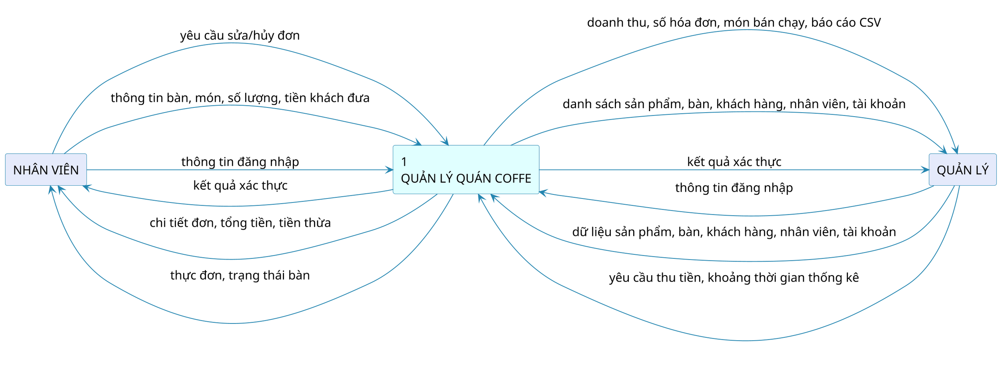
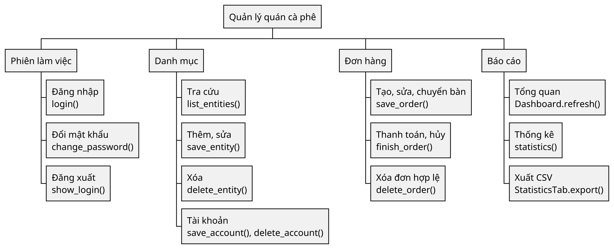
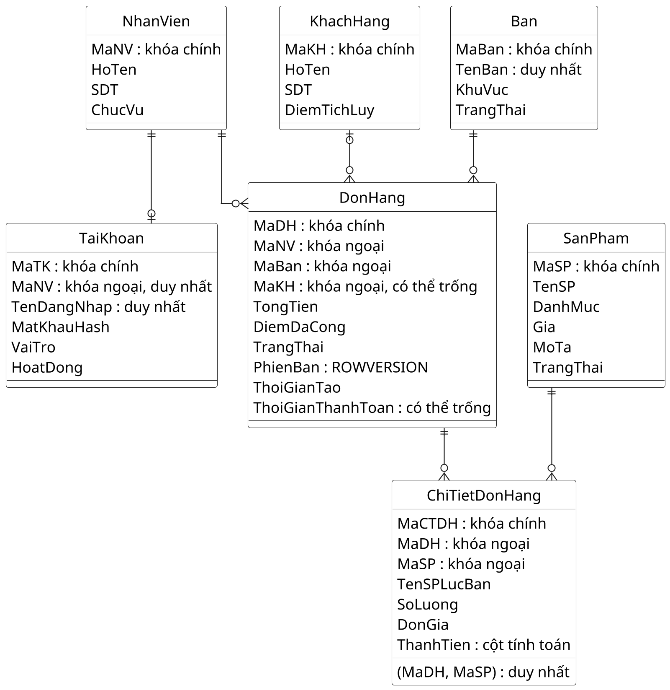
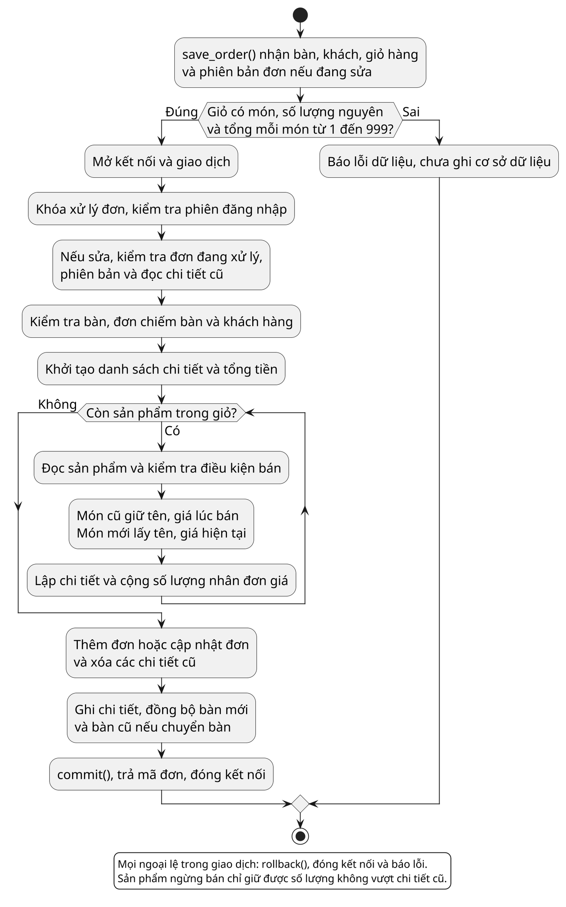
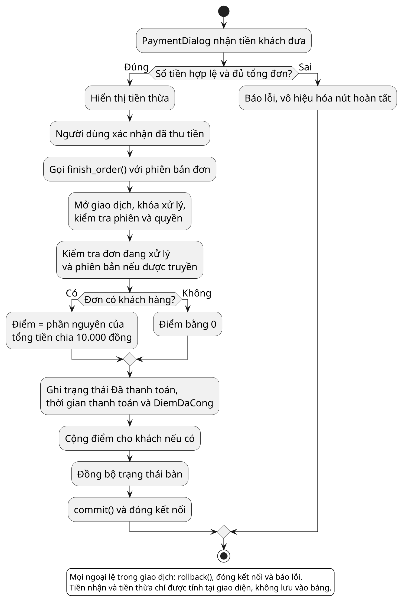

# Quản lý quán cà phê bằng Python

Sinh viên Lê Minh Phú, MSSV 236717, lớp DH23TIN02. Giảng viên Bùi Thị Diễm Trinh.

## Mục lục

- [Mô tả và phạm vi](#mô-tả-và-phạm-vi)
- [Cấu trúc tệp](#cấu-trúc-tệp)
- [Cài đặt và sử dụng](#cài-đặt-và-sử-dụng)
- [Checklist yêu cầu](#checklist-yêu-cầu)
- [Danh sách hình và bảng](#danh-sách-hình-và-bảng)
- [Đối chiếu DFD mức 0](#đối-chiếu-dfd-mức-0)
- [Mã PlantUML](#mã-plantuml)
- [Nhật ký chạy thử và kiểm tra](#nhật-ký-chạy-thử-và-kiểm-tra)
- [Chuẩn bị bảo vệ](#chuẩn-bị-bảo-vệ)

## Mô tả và phạm vi

Ứng dụng Tkinter/ttk trên Windows, kết nối Microsoft SQL Server qua pyodbc. Quản lý có tám trang. Nhân viên chỉ có Đơn hàng, Sơ đồ bàn và Thực đơn. Chức năng gồm danh mục sản phẩm, bàn, nhân viên, khách hàng, tài khoản, gọi món, sửa/chuyển bàn, thanh toán, hủy đơn, thống kê và xuất CSV.

Các điểm có thể trình bày theo tiêu chí chấm mà sinh viên cung cấp:

| Tiêu chí | Minh chứng thực tế |
|---|---|
| Giao diện | Logo, nút và ô nhập bo góc, thẻ bàn, giỏ hàng, phân quyền, trạng thái bằng chữ và màu |
| Kết nối cơ sở dữ liệu | Bảy bảng SQL Server, thêm/đọc/sửa/xóa, khóa ngoại, giao dịch và dữ liệu lưu sau khi mở lại |
| Tập tin | Xuất CSV tiếng Việt bằng csv.writer, chọn nơi lưu và đọc lại để đối chiếu |
| Xử lý | Kiểm tra dữ liệu, giữ giá lúc bán, tính tổng/tiền thừa/điểm, lọc kỳ và tổng hợp doanh thu |

Dự án hiện chỉ xuất CSV, chưa nhập CSV. Nếu giảng viên bắt buộc cả nhập và xuất, tiêu chí đó chưa đủ. Hai tài liệu được cung cấp không xác nhận công thức cộng bốn điểm trên, nên đây là danh sách minh chứng để đối chiếu, không phải cam kết điểm số.

Giới hạn: chưa có in hóa đơn, nguyên liệu, thuế/khuyến mãi, thanh toán ngân hàng, tự động sao lưu, triển khai Internet hoặc thử tải lớn. Tiền khách đưa và tiền thừa chỉ tính trên giao diện.

## Cấu trúc tệp

| Tệp hoặc thư mục | Vai trò |
|---|---|
| main.py | Điểm chạy, CoffeeApp, chuyển màn hình, xử lý lỗi sự kiện |
| database_setup.py | Tạo bảy bảng và dữ liệu ban đầu, chạy lại không xóa dữ liệu |
| db_connection.py | Cấu hình, kết nối SQL và chuyển bản ghi thành danh sách từ điển |
| security.py | Băm và kiểm tra mật khẩu |
| models/__init__.py | Đánh dấu gói models |
| models/service.py | login, kiểm tra dữ liệu/quyền, danh mục, đơn, tài khoản, báo cáo |
| ui/__init__.py | Đánh dấu gói ui |
| ui/theme.py | Màu, chữ, kiểu ttk và ảnh nền control |
| ui/common.py | Biểu mẫu, bảng, tìm kiếm, định dạng, thông báo lỗi |
| ui/chart.py | Biểu đồ Canvas |
| ui/login_window.py | Biểu mẫu đăng nhập |
| ui/main_window.py | Điều hướng theo vai trò và thao tác chung |
| ui/dashboard.py | Tổng quan của quản lý |
| ui/entity_tab.py | Màn hình danh mục sản phẩm, khách, nhân viên |
| ui/account_tab.py | Quản lý tài khoản |
| ui/table_tab.py | Thẻ bàn, thêm/sửa/xóa bàn theo quyền |
| ui/order_tab.py | Danh sách đơn và thao tác trạng thái |
| ui/order_editor.py | Giỏ hàng, gọi món, sửa/chuyển bàn |
| ui/payment_dialog.py | Nhập tiền và xác nhận thu tiền |
| ui/statistics_tab.py | Chọn kỳ, xem thống kê, xuất CSV |
| assets/coffee_logo.png | Logo của ứng dụng |
| assets/controls/ | 23 ảnh nền cần thiết cho nút, ô nhập, danh sách chọn và thẻ |
| tests/test_coffee.py | 19 kiểm thử tích hợp được giữ để tái kiểm tra |
| requirements.txt | Chỉ khai báo pyodbc>=5.2,<6 |
| .gitignore | Bỏ qua bytecode, môi trường Python và log khi quản lý phiên bản |
| docs/BaoCao_QuanLyQuanCaPhe.docx | Báo cáo đã ghi đè, không giữ bản cũ |
| docs/BaoCao_LapTrinhPython_Maubaocao.pdf | Mẫu giảng viên, ưu tiên cao nhất |
| docs/Quyet-dinh-ban-hanh-Qui-dinh-trinh-bay-luan-van-(DNC).pdf | Quy định trường do sinh viên cung cấp |
| docs/DFD_Muc0.png | Ảnh gốc của sinh viên, không sửa |
| sodo/ | Năm mã PlantUML, ảnh dựng tương ứng, bảy ảnh giao diện và logo trường dùng cho bìa |
| README.md | Tài liệu chính đã gộp nội dung, bốn Markdown cũ chưa xóa được do lệnh dọn bị chặn |

Tên tệp Python được giữ vì đã phản ánh đúng trách nhiệm, không cần đổi tên hàng loạt. Các tệp đánh dấu gói rỗng vẫn cần thiết cho cấu trúc nhập mô-đun. Bộ kiểm thử có mục đích sử dụng tiếp, không phải script tạm.

## Cài đặt và sử dụng

Cần Python có Tcl/Tk, SQL Server và ODBC Driver 17 for SQL Server hoặc trình điều khiển SQL Server dự phòng. Môi trường đã chạy: Windows 11 bản dựng 26300, Python 3.14.3, Tk 8.6.15, pyodbc 5.3.0, SQL Server Express 64-bit 16.0.1210.3.

Trong thư mục dự án:

```powershell
python -m pip install -r requirements.txt
python database_setup.py
python main.py
```

Mặc định server `THINKPADX1\SQLSEVER`, database `QuanLyQuanCoffee`, xác thực Windows. Có thể đặt biến môi trường `COFFEE_SQL_SERVER`, `COFFEE_SQL_DATABASE` cho máy thực tế. Tài khoản Windows cần quyền tạo database lần đầu và quyền đọc/ghi khi sử dụng. Thiết lập tạo năm món, tám bàn và tài khoản `admin` với mật khẩu `Admin@123`. Đổi mật khẩu sau lần đăng nhập đầu. Chạy lại thiết lập không đặt lại mật khẩu đã đổi.

Quản lý chuẩn bị danh mục, hồ sơ nhân viên rồi cấp tài khoản. Nhân viên chọn bàn, thêm món, đổi số lượng và lưu đơn. “Lưu & thu tiền” lưu đơn trước khi mở bước thu tiền. Quay lại bước này vẫn giữ đơn đang xử lý. Chỉ xác nhận hoàn tất sau khi nhận đủ tiền. Quản lý chọn kỳ trong Báo cáo doanh thu rồi xuất CSV. F5 làm mới trang hiện tại, trang dài có thể cuộn.

Giá nguyên đồng lớn hơn 0 và không quá 1.000.000.000. Số lượng từ 1 đến 999 sau khi gộp cùng món. Điện thoại có thể trống, nếu nhập dùng 10 số bắt đầu bằng 0 hoặc +84 và 9 số. Mỗi bàn có tối đa một đơn đang xử lý. Món đã lưu giữ tên và giá cũ. Mỗi 10.000 đồng được một điểm, làm tròn xuống, chỉ cộng khi thanh toán cho khách đã chọn. Không sửa/xóa đơn đã thanh toán, không xóa danh mục còn liên kết lịch sử.

## Checklist yêu cầu

Đã đọc đủ ba trang mẫu Python và 18 trang quy định DNC trước khi dọn mã và sửa báo cáo. Quyết định 309/QĐ-ĐHNCT ngày 08/12/2016 là tài liệu được cung cấp, không được diễn giải là bản mới nhất của trường. Mẫu Python được ưu tiên khi hai nguồn khác nhau. Mỗi dòng dưới đây giữ số để đối chiếu cuối.

1. Mẫu Python trang 1: bìa đúng tên trường, đơn vị, học phần, tên đề tài tiếng Việt và tiếng Anh, sinh viên, mã số, lớp và thời điểm báo cáo. **Đạt.**
2. Mẫu Python trang 2: khổ A4, lề trái 3,5 cm, phải 2 cm, trên 2 cm và dưới 2 cm. **Đạt.**
3. Mẫu Python trang 2: bảng mã Unicode, Times New Roman, cỡ 13, giãn dòng 1,2. **Đạt.**
4. Mẫu Python trang 2: không quá 60 trang, không tính phụ lục. **Đạt. Báo cáo 32 trang cả bìa và phụ lục, dưới giới hạn 60 trang.**
5. Mẫu Python trang 2: mục lục tự động, có liên kết và số trang đúng. **Đạt.**
6. Mẫu Python trang 2: danh mục đồ thị, biểu bảng và hình ảnh đồng bộ nội dung. **Đạt.**
7. Mẫu Python trang 2: phần Giới thiệu có Đặt vấn đề trước Những nghiên cứu liên quan. **Đạt.**
8. Mẫu Python trang 2: khảo sát ít nhất năm ứng dụng hoặc thư viện thật và phân tích kỹ một ứng dụng chính. **Đạt.**
9. Mẫu Python trang 2: tiếp theo là Mục tiêu rồi Đối tượng và phạm vi nghiên cứu. **Đạt.**
10. Mẫu Python trang 2: Giới thiệu có DFD cấp 0 và giải thích đường đi từ người dùng, Python đến tệp CSV. **Đạt.**
11. Mẫu Python trang 2: Chương 1 có tên Đặc tả yêu cầu, mô tả đúng các chức năng thật. **Đạt.**
12. Mẫu Python trang 2: Chương 2 có tên Thiết kế giải pháp. **Đạt.**
13. Mẫu Python trang 2: có sơ đồ phân cấp hàm dựa trên tên hàm thật. **Đạt.**
14. Mẫu Python trang 2: có lưu đồ thuật toán cho các chức năng quan trọng. **Đạt.**
15. Mẫu Python trang 2: mô tả danh sách, từ điển và định dạng các cột CSV thật. **Đạt.**
16. Mẫu Python trang 3: Chương 3 có tên Cài đặt giải pháp. **Đạt.**
17. Mẫu Python trang 3: ghi phiên bản Python và môi trường phát triển có bằng chứng, không tự gán IDE chưa dùng. **Chưa đủ thông tin. Đã ghi phiên bản đo được và PowerShell, chưa xác nhận trình soạn thảo/IDE thực tế của sinh viên.**
18. Mẫu Python trang 3: trích mã nguồn quan trọng và giải thích đủ tám nội dung học phần. **Đạt.**
19. Mẫu Python trang 3: Chương 4 có tên Đánh giá kiểm thử. **Đạt.**
20. Mẫu Python trang 3: có mục tiêu, phương pháp, kịch bản, kết quả thực tế và đánh giá mục tiêu. **Đạt.**
21. Mẫu Python trang 3: thử nhập liệu hợp lệ và sai. **Đạt.**
22. Mẫu Python trang 3: thử tính tiền, doanh thu và điểm theo mã thực. **Đạt.**
23. Mẫu Python trang 3: thử lưu trữ sau khi đóng và mở lại, phân biệt với tình huống tắt máy chưa thực hiện. **Đạt phần đóng/mở cửa sổ và kết nối mới. Chưa thử tắt máy rồi khởi động lại, đã nêu rõ trong Chương 4.**
24. Mẫu Python trang 3: kết luận có kết quả đạt được và hướng phát triển. **Đạt.**
25. Mẫu Python trang 3: tài liệu tham khảo thật, có liên kết và được dùng trong nội dung. **Đạt.**
26. Mẫu Python trang 3: phụ lục hướng dẫn cài Python, phụ thuộc, cơ sở dữ liệu và chạy chương trình. **Đạt.**
27. DNC trang 3: giấy trắng, in một mặt, header và footer cách mép 1 cm, không đặt tên đề tài hoặc người trong đầu và chân trang. **Đạt thiết lập tệp. In một mặt là lựa chọn cần giữ khi in giấy, chưa thực hiện in vật lý.**
28. DNC trang 3: thụt đầu đoạn 1 cm, cách trước 6 pt và sau 0 pt. **Đạt.**
29. DNC trang 3: bảng, hình, tài liệu tham khảo và phụ lục giãn dòng đơn. **Đạt.**
30. DNC trang 3: tiếng Việt nhất quán, thuật ngữ ngoại ngữ cần thiết được giải thích. **Đạt.**
31. DNC trang 3: mỗi chương sang trang, tên chương hai dòng, chữ hoa, đậm, cỡ 14, căn giữa. **Đạt.**
32. DNC trang 4: mục cấp một chữ hoa đậm sát trái, mục cấp hai chữ thường đậm cách trái 1 cm, không quá bốn cấp số. **Đạt.**
33. DNC trang 4: tiêu đề chương và mục không có dấu chấm hoặc dấu hai chấm ở cuối. **Đạt.**
34. DNC trang 4: số trang cỡ 13 căn giữa chân trang, phần đầu số La Mã và nội dung số Ả Rập. **Đạt.**
35. DNC trang 4: bảng được nhắc trước khi xuất hiện, không cắt hàng, lặp tiêu đề cột nếu qua trang. **Đạt.**
36. DNC trang 4 và 5: hình được nhắc trước, nằm cùng dòng văn bản, căn giữa, không có khung ngoài. **Đạt.**
37. DNC trang 5: hình và bảng đánh số liên tục theo chương, chú thích cỡ 13, tên bảng ở trên căn trái và tên hình ở dưới căn giữa. **Đạt.**
38. DNC trang 5: công thức trình bày bằng công cụ toán, đánh số, giải thích ký hiệu và đơn vị khi xuất hiện lần đầu. **Không áp dụng công thức toán độc lập. Báo cáo giải thích phép tính bằng lời, số liệu chạy và mã nguồn, không có công thức đặt số.**
39. DNC trang 5: nguồn hình hoặc bảng lấy từ bên ngoài đặt dưới, căn giữa, nghiêng cỡ 11 và có trong tài liệu tham khảo. **Đạt. Bảng khảo sát có nguồn dưới bảng, nghiêng cỡ 11. Sơ đồ và ảnh giao diện do dự án tạo, DFD do sinh viên cung cấp. Logo bìa theo mẫu học phần, không phải hình nội dung.**
40. DNC trang 5 và 6: cột, hàng, đơn vị rõ nghĩa, số thập phân dấu phẩy, hàng nghìn dấu chấm, số liệu căn phải. **Đạt.**
41. DNC trang 6: trích dẫn tác giả và năm, không ghi học hàm hoặc chức danh. **Đạt.**
42. DNC trang 6 và 7: tài liệu trích dẫn và danh mục khớp nhau, chia theo ngôn ngữ, sắp xếp theo tác giả, giữ nguyên tên tài liệu nước ngoài. **Đạt. Các nguồn được trích đều có trong danh mục tiếng Anh. Chữ a, b đi kèm “không ghi năm” chỉ phân biệt tài liệu cùng tác giả, theo quy tắc trích dẫn của DNC, không phải mã chức năng.**
43. DNC trang 7: tài liệu nhiều dòng thụt dòng tiếp theo 1 cm. **Đạt.**
44. DNC trang 12: mục lục đến mục cấp hai, chỉ liệt kê tên chung của phụ lục. **Đạt.**
45. DNC trang 12: danh sách hình và bảng có đúng tên và đúng trang. **Đạt.**
46. DNC trang 13: từ viết tắt được giải thích ở lần đầu và trong danh mục khi cần. **Đạt.**
47. DNC trang 15 đến 17: ghi thông tin nguồn theo loại tài liệu, website có tác giả, năm nếu xác định được, địa chỉ và ngày truy cập thật. **Đạt.**
48. DNC trang 17: phụ lục đặt sau tài liệu tham khảo. **Đạt.**
49. Không áp dụng lề trên và dưới 2,5 cm của DNC vì mẫu học phần ưu tiên lề 2 cm. **Không áp dụng. Lý do nằm ngay trong yêu cầu đối chiếu này.**
50. Không áp dụng mẫu bìa và màu bìa khóa luận ở DNC trang 8 vì giảng viên cung cấp bìa báo cáo học phần riêng. **Không áp dụng. Lý do nằm ngay trong yêu cầu đối chiếu này.**
51. Không áp dụng phụ bìa ở DNC trang 9 vì mẫu học phần không yêu cầu và người dùng đã chọn giữ bố cục học phần. **Không áp dụng. Lý do nằm ngay trong yêu cầu đối chiếu này.**
52. Không áp dụng trang chấp thuận hội đồng ở DNC trang 10 vì đây là báo cáo học phần, chưa có kết quả hội đồng. **Không áp dụng. Lý do nằm ngay trong yêu cầu đối chiếu này.**
53. Không áp dụng lời cảm tạ ở DNC trang 11 vì mẫu học phần không yêu cầu. **Không áp dụng. Lý do nằm ngay trong yêu cầu đối chiếu này.**
54. Không áp dụng cam kết khóa luận ở DNC trang 11 vì không phải khóa luận và không được tự xác nhận thành tích nghiên cứu. **Không áp dụng. Lý do nằm ngay trong yêu cầu đối chiếu này.**
55. Không áp dụng nhận xét cơ quan thực tập vì dự án không có cơ quan thực tập được xác nhận. **Không áp dụng. Lý do nằm ngay trong yêu cầu đối chiếu này.**
56. Không áp dụng cấu trúc năm chương nghiên cứu ở DNC trang 13 đến 15 vì mẫu Python yêu cầu bốn chương cụ thể. **Không áp dụng. Lý do nằm ngay trong yêu cầu đối chiếu này.**
57. Không áp dụng minh họa khảo sát địa bàn, thí nghiệm và giấy phép dữ liệu đề tài cấp khoa vì dự án dùng dữ liệu thử tự tạo, không thực hiện các nội dung đó. **Không áp dụng. Lý do nằm ngay trong yêu cầu đối chiếu này.**
58. Không áp dụng ví dụ trích dẫn sách, hội thảo hoặc luận án không được sử dụng. Chỉ áp dụng quy tắc phù hợp nguồn thực tế. **Không áp dụng. Lý do nằm ngay trong yêu cầu đối chiếu này.**
59. Yêu cầu người dùng: giữ nguyên tất cả ảnh và tệp gốc DFD PowerDesigner, chỉ nêu chênh lệch và tạo mã tương đương để đối chiếu. **Đạt. SHA-256 DFD gốc khớp trước và sau. Không tìm thấy tệp .pdm trong dự án để kiểm tra cấu trúc mô hình.**
60. Yêu cầu người dùng: Python đơn giản, không decorator, không kỹ thuật hoặc thư viện mới, giữ hành vi. **Đạt.**
61. Yêu cầu người dùng: một README.md duy nhất, gộp tài liệu và xóa tài liệu Markdown thừa. **Đã gộp, chưa đạt bước xóa. Cơ chế duyệt tự động chặn lệnh dọn, còn bốn Markdown cũ trong docs.**
62. Yêu cầu người dùng: một thư mục hình sơ đồ, mã PlantUML có nghĩa, render bằng Java trên máy. **Đạt với năm sơ đồ mới trong sodo. Ảnh công cụ cũ trong thư mục tạm chưa dọn được vì lệnh xóa bị chặn.**
63. Yêu cầu người dùng: mọi bảng có đầy đủ đường viền đơn và tiêu đề cụ thể. **Đạt.**
64. Yêu cầu người dùng: không mã chức năng tự đặt, không G.1, không emoji, không placeholder trong báo cáo. **Đạt.**
65. Yêu cầu người dùng: chạy thật các chức năng chính, ghi nhật ký và kết quả có bằng chứng. **Đạt.**
66. Yêu cầu người dùng: kiểm tra tự động số hình, bảng, mục lục, viền, ký tự và mở lại Word. **Đạt. Đã rà trực quan đủ 32 trang, mở lại tệp, kiểm tra 64 liên kết nội bộ, 12 hình và 15 bảng.**
67. Yêu cầu người dùng: không còn bytecode, tệp tạm, log thử nghiệm, bản sao hoặc script thử không dùng. **Chưa đạt. Không có bytecode nhưng lệnh xóa thư mục tạm, ảnh rà trang, CSV sao chép và Markdown cũ bị cơ chế duyệt tự động từ chối với lý do “blocked by policy”.**
68. Ngoại lệ đã được sinh viên chọn: Giới thiệu dùng Hình 1 và Bảng 1, Bảng 2. Các chương vẫn dùng Hình 2.1, Bảng 1.1 theo chương. Không dùng mã G hoặc mã tự đặt. **Đạt.**

Khổ A4, trái 3,5 cm, phải 2 cm, trên/dưới 2 cm. Times New Roman 13, giãn dòng 1,2, thụt đầu 1 cm, trước 6 pt và sau 0 pt. Bảng, hình, tham khảo và phụ lục giãn dòng đơn. Tiêu đề chương hai dòng, 14 đậm căn giữa. Số mục dùng đánh số nhiều cấp của Word. Mục lục và hai danh mục dùng trường TOC có liên kết, chú thích dùng SEQ, số trang dùng PAGE. Khi sửa nội dung trong Word, chọn toàn bộ rồi cập nhật trường, chọn cập nhật toàn bộ mục lục.

Không thêm use case vì mẫu không yêu cầu và không cần để giải thích ứng dụng này. Sơ đồ quan hệ bảy bảng được giữ vì giúp kiểm chứng cấu trúc SQL thật. Hai hình kiến trúc và luồng lưu trữ riêng của bản cũ được bỏ vì nội dung đã thể hiện bằng bảng vai trò tệp, DFD, bảng CSV và phần giải thích. Không có chức năng hoặc kết quả mới được suy ra từ hình tham khảo.

## Danh sách hình và bảng

| Số | Tên | Phần báo cáo |
|---|---|---|
| Hình 1 | Sơ đồ DFD cấp 0 của ứng dụng | Giới thiệu |
| Hình 2.1 | Sơ đồ phân cấp hàm | Chương 2 |
| Hình 2.2 | Quan hệ giữa bảy bảng dữ liệu | Chương 2 |
| Hình 2.3 | Lưu đồ thuật toán lưu đơn hàng | Chương 2 |
| Hình 2.4 | Lưu đồ thuật toán thanh toán đơn | Chương 2 |
| Hình 3.1 | Giao diện đăng nhập | Chương 3 |
| Hình 3.2 | Giao diện tổng quan của quản lý | Chương 3 |
| Hình 3.3 | Giao diện quản lý thực đơn | Chương 3 |
| Hình 3.4 | Giao diện gọi món với tổng đơn 80.000 đồng | Chương 3 |
| Hình 3.5 | Giao diện xác nhận thu tiền | Chương 3 |
| Hình 3.6 | Giao diện báo cáo doanh thu theo kỳ | Chương 3 |
| Hình 3.7 | Giao diện sơ đồ bàn của nhân viên | Chương 3 |

| Số | Tên | Phần báo cáo |
|---|---|---|
| Bảng 1 | Ứng dụng và thư viện được khảo sát | Giới thiệu |
| Bảng 2 | Các luồng dữ liệu trên bản DFD gốc | Giới thiệu |
| Bảng 1.1 | Các chức năng của chương trình | Chương 1 |
| Bảng 1.2 | Quy tắc kiểm tra dữ liệu | Chương 1 |
| Bảng 1.3 | Quyền thao tác theo vai trò | Chương 1 |
| Bảng 2.1 | Vai trò các thành phần mã nguồn | Chương 2 |
| Bảng 2.2 | Các bảng và trường dữ liệu | Chương 2 |
| Bảng 2.3 | Cấu trúc dữ liệu trong bộ nhớ | Chương 2 |
| Bảng 2.4 | Cấu trúc tập tin CSV được xuất | Chương 2 |
| Bảng 3.1 | Môi trường chạy được kiểm tra ngày 20/10/2026 | Chương 3 |
| Bảng 3.2 | Đối chiếu nội dung học phần từ 1 đến 4 | Chương 3 |
| Bảng 3.3 | Đối chiếu nội dung học phần từ 5 đến 8 | Chương 3 |
| Bảng 4.1 | Kết quả kiểm thử dữ liệu và nghiệp vụ | Chương 4 |
| Bảng 4.2 | Kết quả kiểm thử giao dịch, báo cáo và giao diện | Chương 4 |
| Bảng 4.3 | Kết quả chạy thật trên giao diện và SQL Server | Chương 4 |

Logo trên bìa không đánh số hình. Có 12 hình nội dung và 15 bảng. DFD gốc nằm ở docs, các ảnh tạo mới chỉ nằm trong sodo.

## Đối chiếu DFD mức 0

Ảnh `docs/DFD_Muc0.png` được giữ nguyên cả tệp và nội dung chèn Word. Kích thước gốc 927 × 180 điểm ảnh. SHA-256:

```text
D009F45DCA9A9DC0D21B995B116BD83E4EB44539652AA8529EAF1F62E52E4E1C
```

- Hai tác nhân Nhân viên và Quản lý khớp phân quyền. Một tiến trình trung tâm số 1 khớp cách vẽ ngữ cảnh của sinh viên. Khách hàng là dữ liệu, không có màn hình tự đăng nhập để thêm tác nhân khách.
- Nhân viên gửi đăng nhập và dữ liệu đơn, nhận thực đơn, trạng thái bàn, tổng tiền, tiền thừa. Đây là các thao tác có trong LoginWindow, OrderEditor và PaymentDialog.
- Quản lý gửi danh mục, tài khoản và kỳ thống kê, nhận danh sách, doanh thu, số hóa đơn, món bán chạy và CSV. Các hàm tương ứng có thật trong CoffeeService và StatisticsTab.export().
- Không có kho SQL trong ảnh ngữ cảnh. Điều này không tự động làm ảnh sai vì kho bên trong được thể hiện ở phần thiết kế dữ liệu. Đường đi người dùng → Python → CSV được giải thích ngay sau hình trong báo cáo, đúng chức năng chỉ xuất tập tin.
- Điểm có thể làm rõ nếu sinh viên chọn sửa về sau: tách “yêu cầu thu tiền, khoảng thời gian thống kê” thành hai mũi tên. Bổ sung kết quả lưu/sửa/hủy/thanh toán và thông báo lỗi. Chức năng đổi mật khẩu có thật nhưng chưa có nhãn riêng ở DFD.
- Tên trung tâm đang ghi “COFFE”. Mã đối chiếu giữ đúng chữ đó để không tự sửa bản gốc. Tên nghiệp vụ trong phần văn bản là quản lý quán cà phê.
- Chưa có tệp .pdm để xem mô hình PowerDesigner. Không yêu cầu vẽ lại DFD. Nếu muốn hình in rõ hơn, sinh viên có thể xuất lại PNG độ phân giải cao hoặc ảnh vector từ mô hình gốc. Hiện báo cáo đã có Bảng 2 chép đủ 12 luồng để đọc nhãn rõ.

Các điểm trên là đề nghị để sinh viên quyết định, không phải thay đổi đã áp vào bản gốc. Mã PlantUML giữ 12 luồng và hướng, bố trí/hình khối do PlantUML sắp xếp nên không khẳng định giống từng điểm ảnh PowerDesigner.

## Mã PlantUML

Mỗi khối dưới đây là một sơ đồ riêng. Tệp .puml trong sodo có nội dung giống khối tương ứng. Đã dựng bằng Java 27 và plantuml.jar 1.2025.10 có Graphviz cục bộ. Không gọi máy chủ PlantUML, không gửi nội dung dự án ra ngoài.

Tệp jar đang nằm trong .report_work/plantuml.jar vì bước dọn thư mục tạm bị chặn. Đây là công cụ dựng sơ đồ, không phải phụ thuộc chạy ứng dụng. Có thể dùng Java với tệp jar này để dựng lại các mã .puml trong sodo. Không cần Java hoặc PlantUML để chạy ứng dụng và mở báo cáo.

### Hình 1 Sơ đồ DFD cấp 0 của ứng dụng

Giới thiệu, mục 5. Mã tương đương để đối chiếu. Báo cáo chèn ảnh gốc của sinh viên, không chèn ảnh dựng lại.



### Hình 2.1 Sơ đồ phân cấp hàm

Mục 2.1. Đối chiếu main.py, models/service.py, ui/dashboard.py và ui/statistics_tab.py.



### Hình 2.2 Quan hệ giữa bảy bảng dữ liệu

Mục 2.3. Đối chiếu database_setup.py. Không hoặc nhiều chi tiết là ràng buộc ở mức SQL, nghiệp vụ yêu cầu giỏ có món.



### Hình 2.3 Lưu đồ thuật toán lưu đơn hàng

Mục 2.5. Đối chiếu CoffeeService.save_order(). Các ngoại lệ trong giao dịch được giải thích trong chú giải.



### Hình 2.4 Lưu đồ thuật toán thanh toán đơn

Mục 2.6. Đối chiếu PaymentDialog và CoffeeService.finish_order(). Chỉ mô tả nhánh thanh toán, không đồng nhất nhánh hủy với thu tiền.



## Nhật ký chạy thử và kiểm tra

Ngày 20/10/2026, cùng mã nguồn và môi trường đã nêu. Trước khi dọn mã: 19/19 kiểm thử, 18,003 giây. Sau khi dọn: 19/19, 16,156 giây. Thời gian chỉ ghi nhận hai lần chạy, không phải phép đo chứng minh tăng tốc.

```powershell
python -B -m unittest discover -s tests -v
```

Bộ kiểm thử kiểm tra SQL Server thật và Tkinter. Một số thông báo giao diện dùng unittest.mock để không dừng chờ, phần SQL và các giao dịch không bị thay thế. Các nhóm đã đạt: băm/xác thực, nhập sai, thiết lập lặp, danh mục, quyền, tài khoản, đơn/chuyển bàn, giá lúc bán, món ngừng bán, phiên bản cũ, chiếm bàn đồng thời, thanh toán một lần, hoàn tác lỗi, kỳ ngày/tháng/năm nhuận và thao tác chuột/bàn phím control.

Lần chạy bổ sung dùng cửa sổ thật và hộp thoại lưu CSV thật, không thay hộp thoại xuất bằng dữ liệu giả:

| Thời điểm | Thao tác | Kết quả quan sát |
|---|---|---|
| 2026-10-20 01:24:08 | Đăng nhập sai | Hiển thị lỗi và giữ màn hình đăng nhập |
| 2026-10-20 01:24:08 | Đăng nhập quản lý | Đúng tám trang |
| 2026-10-20 01:24:09 | Nhập chữ vào giá sản phẩm | Biểu mẫu giữ lại và báo lỗi |
| 2026-10-20 01:24:09 | Thêm và xoá món kiểm tra | Dữ liệu SQL được thêm rồi xoá đúng |
| 2026-10-20 01:24:11 | Giỏ hàng và số lượng sai | Từ chối chữ, giỏ hợp lệ có tổng 80.000 đồng |
| 2026-10-20 01:24:12 | Thanh toán thật | Tổng 80.000, nhận 100.000, thừa 20.000, cộng 8 điểm |
| 2026-10-20 01:24:12 | Huỷ và xoá đơn chưa thanh toán | Đúng trạng thái, bàn trống, không tạo doanh thu |
| 2026-10-20 01:26:20 | Xuất CSV bằng hộp thoại lưu thật | 1200000.00 đồng, 8 đơn, UTF-8 có BOM |
| 2026-10-20 01:26:22 | Đăng nhập nhân viên | Đúng ba trang đơn hàng, bàn, thực đơn |
| 2026-10-20 01:26:25 | Đóng cửa sổ và mở lại bằng kết nối mới | Đơn đã thanh toán, 80.000 đồng, khách có 8 điểm |

Tập tin xuất gốc được giữ tại `D:\NCTU\Python\ThucHanh\SoLieuCSVProject\doanh_thu_2026-10-14.csv`. Người dùng đã chọn vị trí lưu này. Kỳ 14/10 đến 20/10/2026 có 8 đơn, 1.200.000 đồng. Dòng cà phê đen: 30 ly, 750.000 đồng. Dòng cà phê sữa: 15 ly, 450.000 đồng. Đã đọc lại để xác nhận dấu nhận biết UTF-8, tiêu đề, số đơn và tổng tiền.

Ảnh tổng quan chụp trước khi thanh toán đơn 80.000 đồng nên hiện 85.000 đồng doanh thu hôm nay và một đơn đang phục vụ. Ảnh báo cáo chụp sau thanh toán nên kỳ có 8 đơn. Đây là hai thời điểm khác nhau, không phải số liệu mâu thuẫn.

Cơ sở dữ liệu trình diễn đã được xóa khi kết thúc. Chưa thử tắt máy/khởi động lại, mất điện, tải lớn hoặc bảo mật độc lập. Còn thiếu tên trình soạn thảo/IDE sinh viên thực tế đã dùng. Ảnh DFD độ phân giải cao và .pdm là bổ sung tùy chọn để đối chiếu mô hình, không phải lý do tự vẽ lại bản đã chốt.

Word đã cập nhật trường, lưu và mở để xuất kiểm tra. Đã xem đủ 32 trang. Số hình và bảng liên tục đúng chương, 15 bảng có đủ sáu cạnh viền ngoài/trong dạng đơn, tiêu đề cột lặp và hàng không bị cắt. Có 64 liên kết nội bộ và 13 ảnh cùng dòng gồm logo bìa và 12 hình nội dung. Không có dấu chấm phẩy trong văn bản, mã chức năng tự đặt, placeholder, emoji hoặc ký tự vô hình. Đã phân tích cú pháp đủ 21 tệp Python của ứng dụng và kiểm thử, không còn decorator, yield hoặc hàm bất đồng bộ. Truy vấn lại SQL Server xác nhận không còn cơ sở dữ liệu có tiền tố thử CoffeeTest_.

Bước dọn tệp chưa hoàn tất vì cơ chế duyệt tự động từ chối lệnh xóa với lý do “blocked by policy”. Lệnh bị chặn trước khi thực thi nên các tệp sau vẫn còn:

- docs/YEU_CAU.md, docs/BAO_VE.md, docs/SoDo_PlantUML.md và docs/DanhMuc_SoDo.md. Nội dung đúng đã được gộp vào README, một số hướng dẫn cũ nhắc decorator và mã hình cũ đã lỗi thời.
- docs/doanh_thu_kiem_tra.csv là bản sao tạm dùng đọc lại. Tệp xuất gốc tại SoLieuCSVProject cần được giữ.
- .report_work chứa công cụ, ảnh, bản trích nội dung và dữ liệu kiểm tra tạm. Đây không phải mã chạy của ứng dụng.
- 57 ảnh kiểm tra trong sodo có tên page-1.png đến page-36.png và kiem_tra_mau-*.png, kiem_tra_dnc-*.png. Chỉ 32 trang thuộc bản báo cáo cuối, các ảnh còn lại là lượt rà trước.

Không xóa docs/DFD_Muc0.png, hai PDF yêu cầu, báo cáo DOCX, năm mã .puml và ảnh sơ đồ tương ứng, bảy ảnh giao diện, sodo/logo_truong.png, assets hoặc tests/test_coffee.py. Các mục chưa đạt được ghi rõ ở dòng 17, 23, 61, 62 và 67 để tránh xác nhận hoàn tất sai thực tế.

## Chuẩn bị bảo vệ

1. Đăng nhập quản lý, giới thiệu tổng quan và màu/trạng thái.
2. Thêm hoặc sửa món, tìm kiếm không dấu, giải thích dữ liệu ghi vào SQL.
3. Đăng nhập nhân viên để chỉ ra ba trang và quyền bị giới hạn ở cả giao diện lẫn CoffeeService.
4. Tạo đơn hai cà phê đen và một cà phê sữa. Giải thích 80.000 đồng, lưu, mở lại và chuyển bàn hợp lệ.
5. Thử tiền thiếu rồi nhận 100.000 đồng. Kiểm tra thừa 20.000 đồng, điểm khách và bàn trống.
6. Quản lý xem báo cáo, xuất CSV, đọc lại tổng và số đơn. Dữ liệu doanh thu tại buổi trình bày phụ thuộc các đơn thực tế lúc đó, không cam kết luôn là 1.200.000 đồng.
7. Giải thích vòng lặp gộp giỏ, giữ giá lúc bán, commit/rollback/finally và kiểm thử. Không chạy bộ kiểm thử giữa phần trình diễn vì sẽ mở nhiều cửa sổ thử.

Các điểm cần nắm: `Decimal` giúp tính tiền thập phân, `ROWVERSION` phát hiện đơn cũ, khóa giao dịch và chỉ mục duy nhất ngăn thao tác trùng, tham số `?` bảo vệ giá trị truy vấn. `ENTITIES` giới hạn tên bảng/cột. PBKDF2 trong security.py không lưu mật khẩu gốc. Dữ liệu ngẫu nhiên riêng làm cùng mật khẩu có giá trị băm khác nhau. Chi tiết đơn tách riêng để lưu nhiều món và giữ lịch sử tên/giá. Đơn khách lẻ để MaKH trống, không tạo khách giả.

Mã không còn decorator hoặc hàm giao dịch dùng generator. Các thao tác ghi dùng try/except/finally trực tiếp. Thư viện chạy ứng dụng không tăng. Tên login hiện là hàm của models/service.py, không còn CoffeeService.login. Hướng dẫn cũ nhắc guarded và transaction đã được thay bằng nội dung đúng với mã hiện tại.
