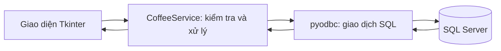
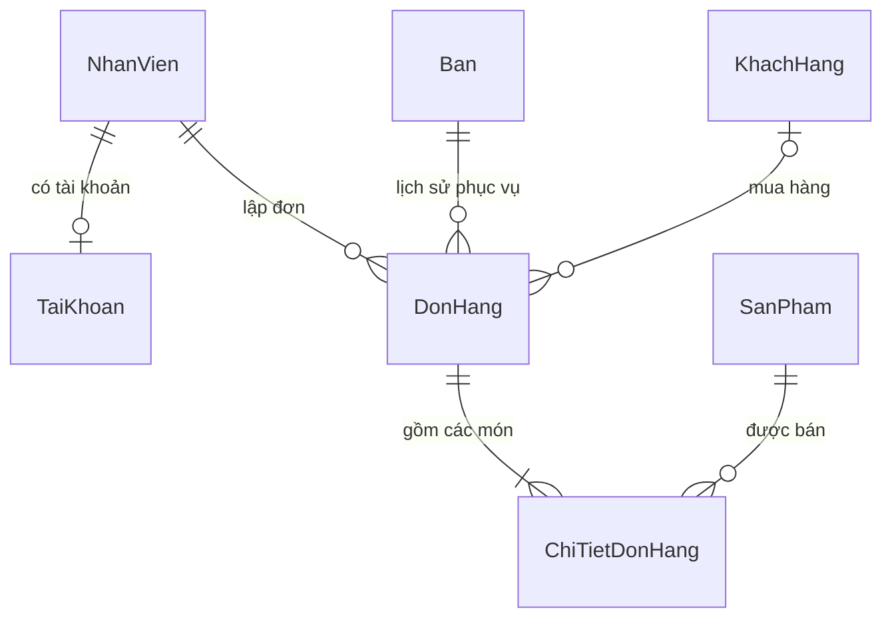

# Thuyết minh và chuẩn bị bảo vệ

## 1. Trình bày bài toán

Quán cần biết bàn nào còn trống, từng bàn đang gọi món gì, số tiền cần thu và doanh thu trong kỳ. Có hai vai trò: nhân viên phục vụ xử lý đơn; quản lý theo dõi doanh thu và quản trị danh mục, nhân sự, tài khoản.

Phạm vi là một quán nhỏ trên desktop. Chưa triển khai kho nguyên liệu, thanh toán ngân hàng, hoá đơn điện tử hoặc đồng bộ nhiều chi nhánh.

## 2. Đọc mã theo thứ tự

| Tệp | Cần nắm |
|---|---|
| `main.py` | Tạo cửa sổ Tkinter, đăng nhập/đăng xuất, ghi lỗi |
| `db_connection.py` | Kết nối pyodbc, commit, rollback, đóng kết nối |
| `database_setup.py` | Bảy bảng, khoá ngoại, ràng buộc, dữ liệu mẫu |
| `security.py` | Hash mật khẩu có salt, kiểm tra mật khẩu |
| `models/service.py` | Kiểm tra dữ liệu và quyền; CRUD; xử lý đơn; thống kê |
| `ui/main_window.py` | Hiện các trang theo vai trò, điều hướng, làm mới |
| `ui/order_editor.py` | Giỏ hàng Python và cách lưu xuống database |
| `ui/payment_dialog.py` | Tiền khách đưa, tiền thừa, xác nhận thu tiền |
| `ui/theme.py`, `ui/common.py` | Màu/kiểu chữ và các thành phần dùng chung |
| Các tệp còn lại trong `ui/` | Mỗi tệp phụ trách một màn hình hoặc biểu đồ |

Các màn hình chỉ nhận dữ liệu và gọi hàm nghiệp vụ. SQL tập trung trong service và module thiết lập. Không có ORM, API web hay cơ chế plugin trong ứng dụng.

`guarded` là một decorator: bọc sự kiện bấm nút bằng `try/except` để báo lỗi, tránh lặp lại cùng khối xử lý trong mọi màn hình. `transaction()` dùng `contextmanager`: thành công thì commit, lỗi thì rollback, cuối cùng luôn đóng kết nối.

### Giải thích giao diện bo góc

Ứng dụng vẫn dùng `ttk.Button`, `Entry`, `Combobox`, `Spinbox`, `Checkbutton` và `Treeview`. Hàm `rounded_controls()` chỉ thay lớp vẽ bằng `ttk.Style`, không tự viết lại sự kiện chuột/bàn phím hay tạo một bộ widget riêng. Logo và 23 ảnh control nằm trong `assets/`, Tkinter đọc trực tiếp bằng `PhotoImage`.

Ảnh được chia thành góc, cạnh và phần giữa: góc giữ nguyên, phần giữa lặp để phủ kích thước control. Ảnh nền 128 × 128 giúp tránh lặp quá nhiều ô nhỏ khi vẽ thẻ lớn; kích thước tối thiểu của control được đặt riêng. Các tham chiếu ảnh được giữ trên cửa sổ gốc để ảnh không bị thu hồi. Kiểu `Card.*` chỉ đổi nền ở góc bo khi control nằm trên thẻ trắng.

Để giải thích lựa chọn UX: màu chính chỉ dành cho hành động cần ưu tiên; trạng thái luôn có chữ; nút không hợp lệ bị vô hiệu hoá; hai nút lưu/thu tiền đặt cùng hàng để giỏ hàng vẫn hiển thị ở cửa sổ nhỏ. Không cần thư viện đồ hoạ hoặc hiệu ứng động bổ sung.

## 3. Mô hình dữ liệu

- Một đơn gồm nhiều dòng chi tiết; mỗi dòng lưu mã sản phẩm, tên lúc bán, số lượng, đơn giá.
- `ThanhTien = SoLuong * DonGia` là cột tính toán trong SQL Server.
- `TongTien` trong đơn là tổng các dòng. Ứng dụng dùng `Decimal`, SQL dùng `DECIMAL(18,2)` để tính tiền.
- Đơn không có khách đăng ký lưu `MaKH = NULL`, không tạo khách giả.
- `MaNV` ghi nhận nhân viên lập đơn, không thay đổi khi người khác tiếp tục phục vụ.
- `ThoiGianTao` phục vụ lịch sử; `ThoiGianThanhToan` dùng để tính doanh thu.

## 4. Ba luồng cần giải thích được

### Lập và sửa đơn

1. Nhân viên chọn bàn và bấm các thẻ món.
2. Giỏ hàng là dictionary, khoá là mã sản phẩm; thêm cùng món thì tăng số lượng.
3. Khi lưu, service kiểm tra tài khoản, bàn, sản phẩm và số lượng.
4. Đơn giá được lấy từ database; món đã lưu giữ đơn giá cũ.
5. Ghi đơn, chi tiết và trạng thái bàn trong một giao dịch.

Giỏ chưa lưu chỉ ở bộ nhớ. Đóng khi có thay đổi sẽ hỏi xác nhận bỏ thay đổi. Nút **Lưu & thu tiền** lưu đơn trước rồi mở màn hình thu tiền; nếu quay lại ở màn hình thu tiền, đơn vẫn ở trạng thái đang xử lý.

### Thanh toán

1. Đọc tổng tiền và phiên bản mới nhất của đơn.
2. Nhập số tiền khách đưa; số tiền này dùng để hỗ trợ tính tiền thừa, không được lưu như một giao dịch ngân hàng.
3. Chỉ cho xác nhận khi nhận đủ tiền.
4. Service kiểm tra đơn còn đang xử lý và chưa bị chỉnh sửa ở cửa sổ khác.
5. Cập nhật trạng thái, thời gian thanh toán, điểm khách và bàn trong cùng giao dịch.
6. Khi thành công, báo cáo lấy được doanh thu mới.

### Báo cáo

Chỉ Quản lý được gọi các hàm thống kê. Bộ lọc dùng khoảng `[ngày đầu, ngày sau ngày cuối)`, vì vậy không bỏ sót hoá đơn thanh toán lúc cuối ngày. Chỉ lấy trạng thái **Đã thanh toán**; đơn huỷ và đang phục vụ không tạo doanh thu.

Biểu đồ lấy dữ liệu SQL thật, không gán số minh hoạ. Kỳ tối đa 31 ngày dùng cột theo ngày; kỳ dài hơn dùng cột theo tháng, hiển thị tối đa 12 tháng cuối. Tổng doanh thu và bảng món bán chạy vẫn tính toàn bộ kỳ đã chọn.

## 5. Vì sao có các cơ chế bảo vệ này?

| Cơ chế | Lý do | Tệp/hàm |
|---|---|---|
| Placeholder `?` | Dữ liệu nhập không trở thành câu lệnh SQL | Các truy vấn trong service |
| Danh sách cố định `ENTITIES` | Tên bảng/cột được chọn từ mã nguồn, không lấy từ người dùng | `save_entity`, `delete_entity` |
| Khoá ngoại | Không xoá dữ liệu đang được lịch sử sử dụng | `database_setup.py` |
| Chỉ mục duy nhất có điều kiện | Mỗi bàn chỉ có một đơn đang xử lý | `UX_Ban_DonDangXuLy` |
| Transaction | Tránh đơn đã thanh toán nhưng bàn/điểm chưa cập nhật | `transaction`, `finish_order` |
| Khoá giao dịch `sp_getapplock` | Hai cửa sổ không đồng thời chiếm cùng bàn hoặc thanh toán cùng đơn | `_lock` |
| `ROWVERSION` | Biết đơn đã bị sửa kể từ lần đọc trước, chặn ghi đè dữ liệu cũ | `PhienBan`, `expected_version` |
| PBKDF2 và salt | Không lưu mật khẩu gốc, cùng mật khẩu có hash khác nhau | `security.py` |
| Kiểm tra quyền trong service | Không chỉ dựa vào việc ẩn nút | `_authorize` |

`ROWVERSION` là số phiên bản tự đổi của SQL Server, không phải ngày giờ. `sp_getapplock` chỉ khoá trong thời gian giao dịch ngắn; phù hợp quán nhỏ. Nếu mở rộng quy mô, đây là phần cần đánh giá lại thay vì khẳng định ứng dụng đã đáp ứng mọi tải.

## 6. Kịch bản trình diễn khoảng 7–10 phút

1. **Đăng nhập quản lý**: giới thiệu tổng quan, màu sắc/trạng thái, cách đổi trang.
2. **Chuẩn bị dữ liệu**: thêm một nhân viên, cấp tài khoản Nhân viên, thêm một khách hàng và một món.
3. **Đăng nhập nhân viên**: chỉ còn sơ đồ bàn, đơn hàng, thực đơn; không có ánhân sự, tài khoản, bo cáo.
4. **Gọi món**: chọn bàn trống, thêm hai món, tăng/giảm số lượng, lưu. Chỉ ra bàn chuyển sang Đang phục vụ.
5. **Sửa đơn**: mở lại từ sơ đồ bàn, thêm món hoặc chuyển bàn; bàn cũ được giải phóng.
6. **Thu tiền**: thử nhập thiếu tiền để thấy nút xác nhận bị khoá, sau đó nhập đủ và hoàn tất. Chỉ ra tiền thừa và bàn trống.
7. **Quản lý xem báo cáo**: chọn Hôm nay/7 ngày/Tháng này, giải thích biểu đồ và món bán chạy. Xuất CSV nếu cần.
8. **Kiểm tra lỗi**: nhập giá âm; thử xoá món đã bán; chỉ ra thông báo và dữ liệu không bị hỏng.

Hãy chạy thử toàn bộ kịch bản trước buổi bảo vệ. Không chạy kiểm thử tự động giữa phần trình diễn, vì nó mở nhiều cửa sổ kiểm tra tạm thời.

## 7. Câu hỏi nên tự trả lời

1. **Vì sao chọn Tkinter?** Có sẵn trong Python, phù hợp ứng dụng desktop nhỏ và nội dung môn học; ttk hỗ trợ bảng, nhập liệu và sự kiện.
2. **Tại sao tách đơn và chi tiết đơn?** Một đơn có nhiều sản phẩm; tách bảng tránh lặp thông tin bàn/khách/nhân viên trên từng dòng.
3. **Đổi giá menu có đổi hoá đơn cũ không?** Không. Chi tiết đơn có đơn giá và tên sản phẩm tại thời điểm bán.
4. **Tại sao không dùng số thực cho tiền?** Số thực nhị phân có sai số; Decimal và DECIMAL phù hợp số tiền thập phân.
5. **Mất kết nối lúc thanh toán thì sao?** Giao dịch không hoàn tất sẽ rollback; mở lại để kiểm tra trạng thái trước khi thao tác tiếp.
6. **Hai người chọn cùng một bàn?** Có khoá nghiệp vụ và chỉ mục duy nhất chặn đơn đang xử lý thứ hai.
7. **Nhân viên gọi trực tiếp hàm thống kê?** Service vẫn kiểm tra vai trò và từ chối.
8. **Tại sao không xoá hoá đơn đã thanh toán?** Để bảo toàn lịch sử doanh thu và điểm khách đã cộng.
9. **Điểm được cộng thế nào?** `int(TongTien // 10000)`, chỉ cộng một lần khi thanh toán, không cộng cho Khách lẻ.
10. **Biểu đồ vẽ bằng gì?** Tkinter Canvas; SQL tổng hợp tiền, Canvas đổi giá trị thành chiều cao cột.
11. **Bộ kiểm thử có ảnh hưởng dữ liệu quán không?** Nó tạo database tên ngẫu nhiên `CoffeeTest_...`, kiểm tra rồi tự xoá database đó.
12. **Đã kiểm thử điều gì?** 19 kiểm thử: CRUD, quyền, mật khẩu, bàn/đơn, giá cũ, thanh toán trùng, thao tác đồng thời, rollback, báo cáo, luồng giao diện và thao tác chuột/bàn phím của control bo góc.

## 8. Phạm vi cần nói rõ

- Chạy nội bộ bằng Windows Authentication; chưa có quản trị từ Internet.
- Số tiền khách đưa không phải tích hợp ngân hàng hoặc xác minh đã chuyển khoản.
- Giới hạn hiện tại: chưa có in hoá đơn, quản lý kho, giảm giá/thuế, nhật ký kiểm toán đầy đủ hoặc tự động sao lưu.
- Cần giải thích được mã và các quyết định thiết kế bằng lời của mình, đối chiếu rubric của môn. Chức năng chạy đúng là bằng chứng kỹ thuật, không phải cam kết điểm số.
