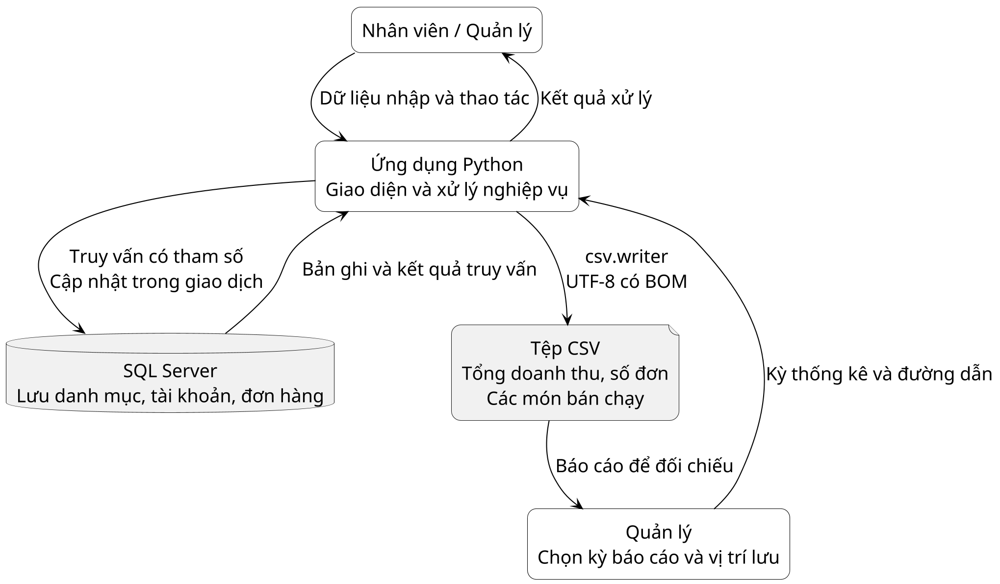
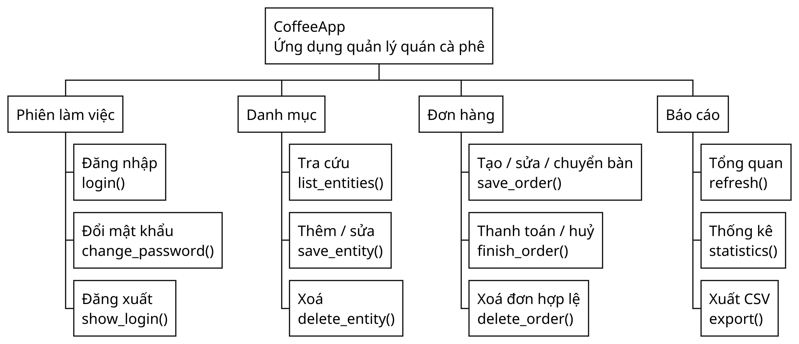
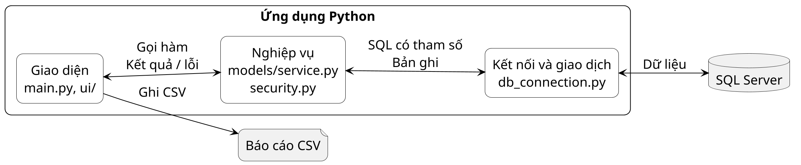
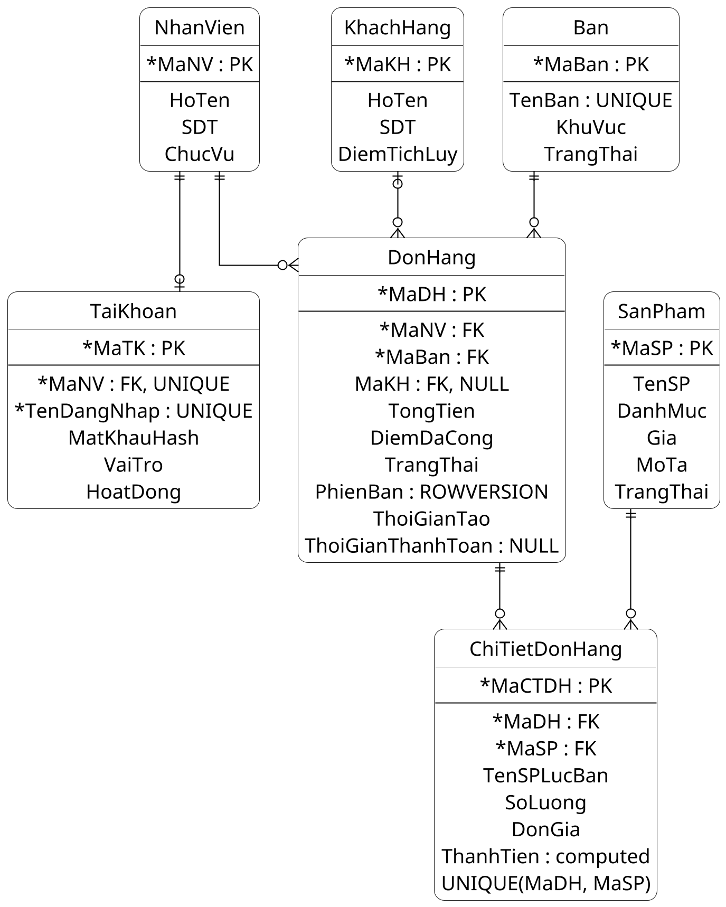
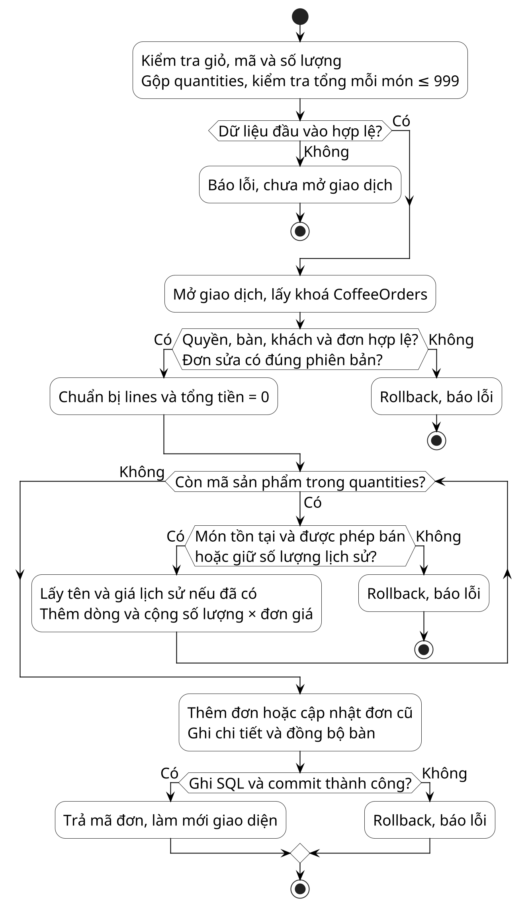
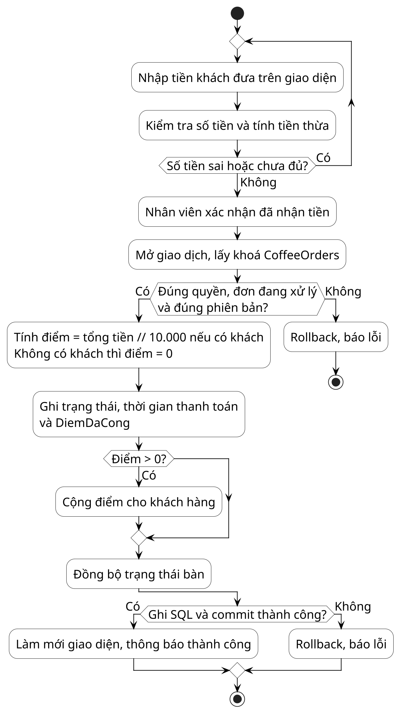

# Mã sơ đồ đối chiếu dự án Coffee

Mở [PlantUML Editor](https://editor.plantuml.com/), xoá mã mẫu và dán nguyên một khối bên dưới, từ dòng bắt đầu đến dòng kết thúc. Chọn SVG hoặc PNG để xem và tải hình. Không dán đồng thời nhiều sơ đồ vào một ô.

Các sơ đồ mô tả phiên bản mã nguồn trong dự án. Kiểm tra cú pháp sinh hình không thay thế việc đối chiếu nghiệp vụ. Các điểm cần phân biệt được ghi bên dưới từng sơ đồ.

## Quy tắc áp dụng cho báo cáo

Giữ bìa, phần giới thiệu và bốn chương của mẫu học phần Python. Không thêm trang hội đồng xét duyệt, nhận xét thực tập, lời cảm tạ hoặc cam kết. Mẫu Python yêu cầu lề trên và dưới 2 cm, nên giữ 2 cm thay vì 2,5 cm của quy định DNC. Lề trái 3,5 cm, phải 2 cm. Văn bản Times New Roman 13, giãn dòng 1,2, thụt đầu dòng 1 cm, cách trước 6 pt và sau 0 pt. Bảng, tài liệu tham khảo và phụ lục dùng giãn dòng đơn theo hướng dẫn riêng của DNC. Chương mới bắt đầu ở trang mới, tiêu đề 14 đậm và căn giữa. Các hình và bảng đánh số theo chương. Ký hiệu G dùng cho phần Giới thiệu, A dùng cho Phụ lục. Mục lục và danh mục hình/bảng là trường tự động của Word. Trích dẫn dùng tác giả và năm, nguồn không nêu năm được ghi “không ghi năm”.

Tài liệu đối chiếu: BaoCao_LapTrinhPython_Maubaocao.pdf và Quyết định 309/QĐ-ĐHNCT ngày 08/12/2016 do người dùng cung cấp. Quyết định này là tài liệu quy định được cung cấp, không khẳng định là phiên bản mới nhất đang áp dụng.

## DFD mức 0 đã hoàn thành

Giữ nguyên bản vẽ do sinh viên cung cấp trong DFD_Muc0.png. Không sinh lại sơ đồ này bằng mã. Danh sách các sơ đồ cần tự vẽ nằm trong DanhMuc_SoDo.md.

## Luồng lưu trữ và xuất tệp

Đối chiếu: `db_connection.py, ui/statistics_tab.py`.

Đây là sơ đồ luồng lưu trữ, không gọi là DFD cấp 0. SQL Server lưu dữ liệu chính. CSV chỉ xuất từ ứng dụng, không có luồng nhập CSV.

## Phân rã chức năng và hàm chính

Đối chiếu: `main.py, models/service.py, ui/dashboard.py, ui/statistics_tab.py`.

Đường nối WBS biểu diễn quan hệ phân rã, không biểu diễn thứ tự chạy. login, change_password, list_entities, save_entity, delete_entity, save_order, finish_order, delete_order và statistics là phương thức CoffeeService. show_login thuộc CoffeeApp, refresh thuộc Dashboard, export thuộc StatisticsTab. Các hàm tài khoản save_account, delete_account, list_accounts nằm trong nhóm danh mục, không đồng nhất với các hàm entity. Sơ đồ chọn các hàm chính, không liệt kê mọi hàm phụ.

## Tổ chức mã nguồn

Đối chiếu: `main.py, ui/, models/service.py, security.py, db_connection.py`.

Các phần Python chạy trong cùng chương trình. SQL Server là hệ quản trị dữ liệu. Chức năng ghi CSV thuộc giao diện StatisticsTab, lấy số liệu từ CoffeeService.

## Quan hệ dữ liệu

Đối chiếu: `database_setup.py`.

Dấu || là đúng một, |o là không hoặc một, o{ là không hoặc nhiều. Mỗi TaiKhoan bắt buộc thuộc một NhanVien, mỗi NhanVien có tối đa một TaiKhoan. MaKH của DonHang có thể NULL. Quan hệ đơn–chi tiết thể hiện ràng buộc SQL có thể không có chi tiết, trong khi save_order luôn yêu cầu giỏ không rỗng. MaDH trong ChiTietDonHang có ON DELETE CASCADE. Đơn đang xử lý có chỉ mục duy nhất theo MaBan. Sơ đồ thể hiện trường quan trọng, không phải mọi chi tiết kiểu dữ liệu.

## Lưu đồ lưu đơn

Đối chiếu: `CoffeeService.save_order, db_connection.transaction`.

Kiểm tra giỏ và gộp số lượng trước khi mở giao dịch. Kiểm tra từng sản phẩm bên trong vòng lặp. Món đã có trong đơn dùng tên và đơn giá lịch sử. Món ngừng bán chỉ được giữ hoặc giảm số lượng cũ. Khi đổi bàn phải đồng bộ bàn mới và bàn cũ. Mọi ngoại lệ trong khối giao dịch đều dẫn đến rollback, kể cả lỗi đọc SQL, lấy khoá hoặc kiểm tra. Các nhánh rollback trong hình là cách trình bày gọn của cơ chế ngoại lệ này.

## Lưu đồ thanh toán

Đối chiếu: `PaymentDialog.change_amount/confirm, CoffeeService.finish_order, db_connection.transaction`.

Số tiền nhận và tiền thừa được kiểm tra trên giao diện, không lưu vào SQL. Giao diện luôn truyền expected_version. Dịch vụ cho phép tham số này là None khi được gọi riêng. Điểm chỉ cộng cho khách được chọn, theo phép chia lấy phần nguyên. Khối giao dịch cập nhật đơn, khách và bàn cùng nhau. Mọi ngoại lệ trong khối giao dịch đều rollback. Nếu người dùng đóng hộp thoại khi đang nhập thì thao tác kết thúc và chưa ghi thanh toán. Sơ đồ mô tả nhánh thanh toán, nhánh huỷ dùng cùng finish_order nhưng không cộng điểm.

